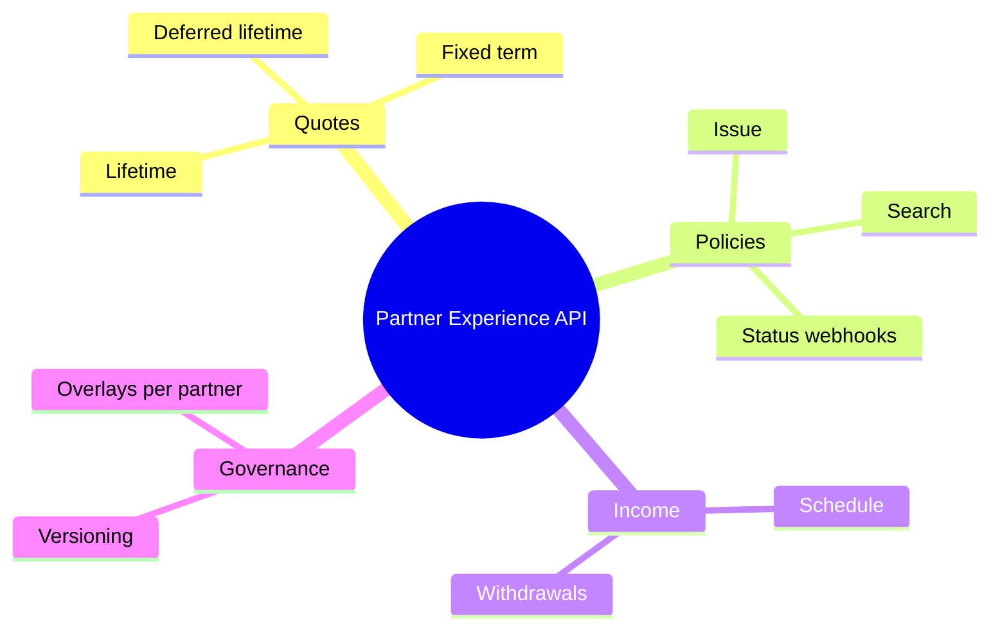
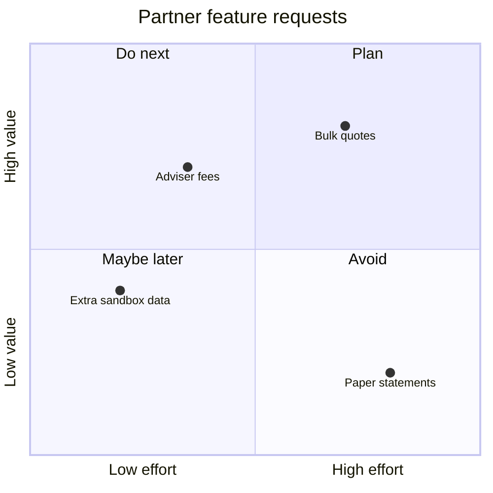
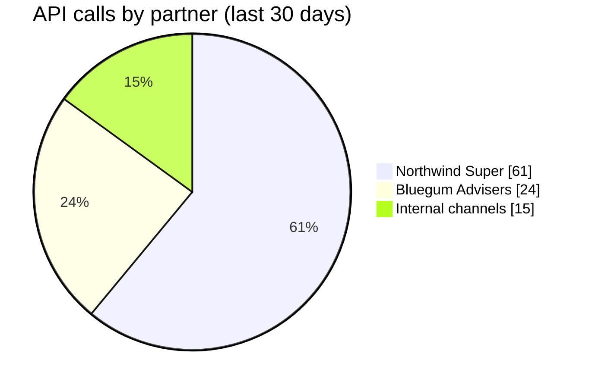
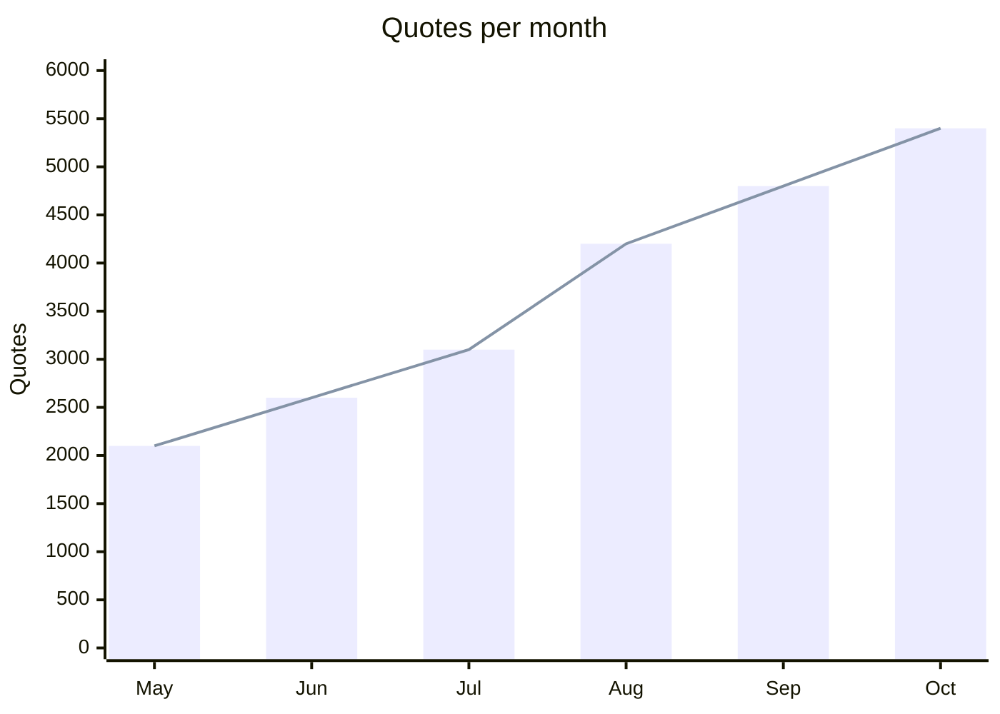
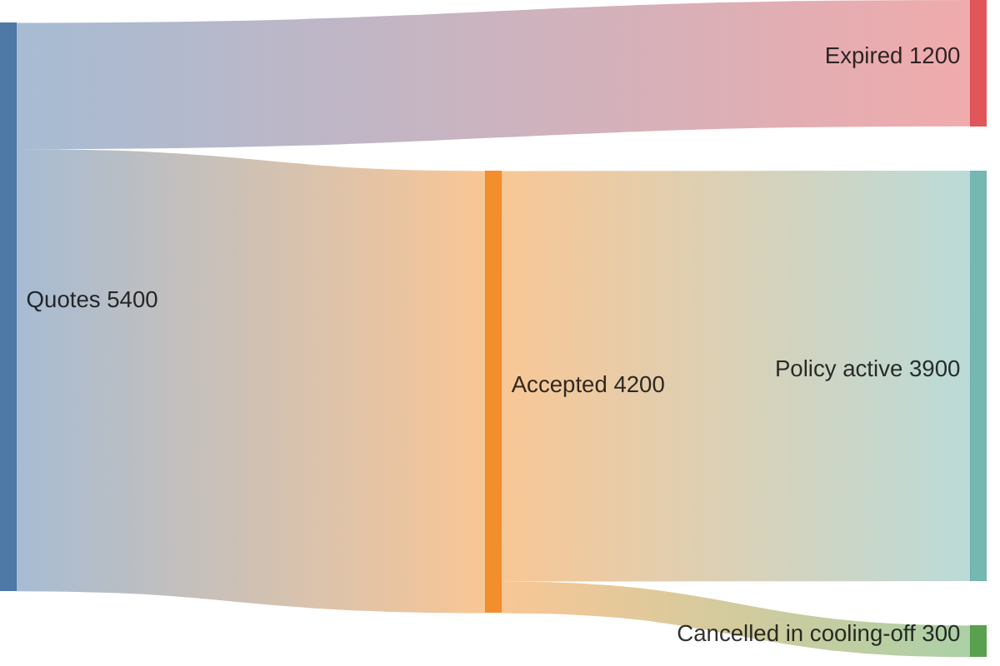

# Analysis and communication

Ideas, priorities and numbers for planning sessions and reports.

## Mind map

**Use it for:** Capability maps and brainstorming.



<details>
<summary>Mermaid source</summary>

````text
mindmap
  root((Partner Experience API))
    Quotes
      Lifetime
      Fixed term
      Deferred lifetime
    Policies
      Issue
      Search
      Status webhooks
    Income
      Schedule
      Withdrawals
    Governance
      Overlays per partner
      Versioning
````

</details>

## Quadrant chart

**Use it for:** Prioritise partners or features on two dimensions.



<details>
<summary>Mermaid source</summary>

````text
quadrantChart
  title Partner feature requests
  x-axis Low effort --> High effort
  y-axis Low value --> High value
  quadrant-1 Plan
  quadrant-2 Do next
  quadrant-3 Maybe later
  quadrant-4 Avoid
  Bulk quotes: [0.7, 0.8]
  Adviser fees: [0.35, 0.7]
  Paper statements: [0.8, 0.2]
  Extra sandbox data: [0.2, 0.4]
````

</details>

## Pie chart

**Use it for:** Simple share-of-total, e.g. traffic by partner.



<details>
<summary>Mermaid source</summary>

````text
pie showData
  title API calls by partner (last 30 days)
  "Northwind Super" : 61
  "Bluegum Advisers" : 24
  "Internal channels" : 15
````

</details>

## XY chart

**Use it for:** Trends over time: volumes, latency, error rates.



<details>
<summary>Mermaid source</summary>

````text
xychart-beta
  title "Quotes per month"
  x-axis [May, Jun, Jul, Aug, Sep, Oct]
  y-axis "Quotes" 0 --> 6000
  bar [2100, 2600, 3100, 4200, 4800, 5400]
  line [2100, 2600, 3100, 4200, 4800, 5400]
````

</details>

## Sankey diagram

**Use it for:** Flows of money or volume between stages.



<details>
<summary>Mermaid source</summary>

````text
sankey-beta
Quotes,Accepted,4200
Quotes,Expired,1200
Accepted,Policy active,3900
Accepted,Cancelled in cooling-off,300
````

</details>
