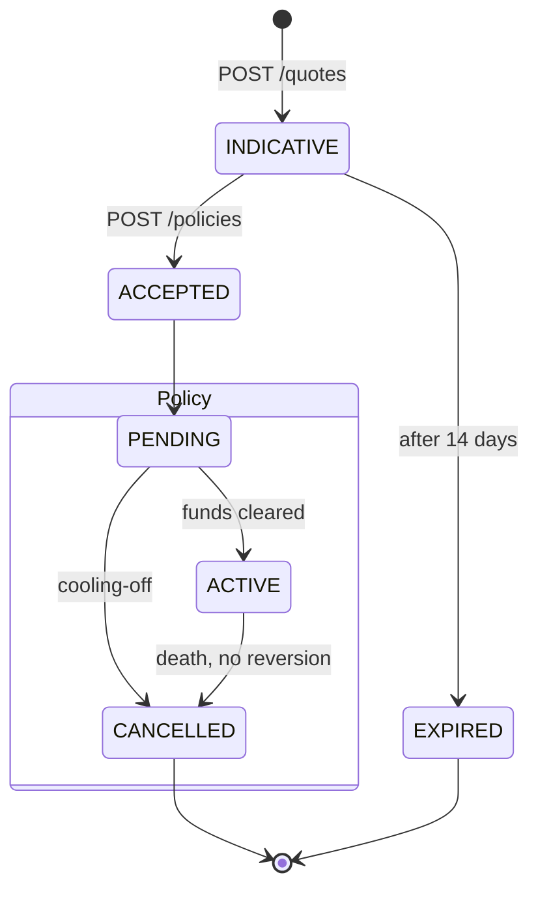

# Behaviour and lifecycle

How a thing changes over time: statuses, transitions and the events that cause them.

## State diagram

**Use it for:** Status lifecycles: the allowed transitions are part of the contract.



<details>
<summary>Mermaid source</summary>

````text
stateDiagram-v2
  [*] --> INDICATIVE: POST /quotes
  INDICATIVE --> ACCEPTED: POST /policies
  INDICATIVE --> EXPIRED: after 14 days
  ACCEPTED --> PENDING
  state Policy {
    PENDING --> ACTIVE: funds cleared
    PENDING --> CANCELLED: cooling-off
    ACTIVE --> CANCELLED: death, no reversion
  }
  CANCELLED --> [*]
  EXPIRED --> [*]
````

</details>
