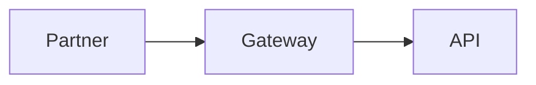

# Diagrams as code

Every diagram on this site is written in [Mermaid](https://mermaid.js.org/) inside the Markdown page, so it is reviewed in pull requests, versioned with the content and never goes stale in a separate drawing tool.

To add one, write a fenced code block with the language `mermaid`:

````md

````

Each example below shows the rendered diagram and its source, ready to copy.

| Diagram | Section | Use it for |
|---|---|---|
| [Flowchart](process-and-interaction.md#flowchart) | Process and interaction | Decision logic, approval processes, request routing. |
| [Sequence diagram](process-and-interaction.md#sequence-diagram) | Process and interaction | API call order across services, authentication flows, webhooks. |
| [User journey](process-and-interaction.md#user-journey) | Process and interaction | How a partner developer or customer experiences a process, step by step. |
| [Entity relationship diagram](structure-and-data.md#entity-relationship-diagram) | Structure and data | Database or data-model relationships with cardinality. |
| [Class diagram](structure-and-data.md#class-diagram) | Structure and data | Object models and inheritance, e.g. canonical model families. |
| [C4 context diagram](structure-and-data.md#c4-context-diagram) | Structure and data | Who uses the system and which external systems it talks to (C4 level 1). |
| [Architecture diagram](structure-and-data.md#architecture-diagram) | Structure and data | Cloud and deployment topology with service groups. |
| [Block diagram](structure-and-data.md#block-diagram) | Structure and data | Layered capability or component views without flow direction. |
| [Requirement diagram](structure-and-data.md#requirement-diagram) | Structure and data | Trace requirements to the components that satisfy them. |
| [State diagram](behaviour.md#state-diagram) | Behaviour and lifecycle | Status lifecycles: the allowed transitions are part of the contract. |
| [Gantt chart](planning-and-change.md#gantt-chart) | Planning and change | Delivery plans and partner onboarding schedules. |
| [Timeline](planning-and-change.md#timeline) | Planning and change | Version history, deprecations and sunsets. |
| [Git graph](planning-and-change.md#git-graph) | Planning and change | Branching and release strategy for contracts. |
| [Kanban board](planning-and-change.md#kanban-board) | Planning and change | Work in progress for contract changes or partner requests. |
| [Mind map](analysis.md#mind-map) | Analysis and communication | Capability maps and brainstorming. |
| [Quadrant chart](analysis.md#quadrant-chart) | Analysis and communication | Prioritise partners or features on two dimensions. |
| [Pie chart](analysis.md#pie-chart) | Analysis and communication | Simple share-of-total, e.g. traffic by partner. |
| [XY chart](analysis.md#xy-chart) | Analysis and communication | Trends over time: volumes, latency, error rates. |
| [Sankey diagram](analysis.md#sankey-diagram) | Analysis and communication | Flows of money or volume between stages. |

:::tip Editing tips
- The [Mermaid live editor](https://mermaid.live) previews diagrams as you type; paste the result back into the page.
- Keep one idea per diagram. A sequence diagram with more than about 15 messages usually wants splitting.
- Diagrams follow the site's light or dark theme automatically.
:::
