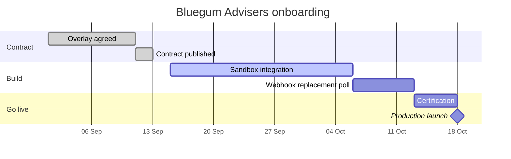
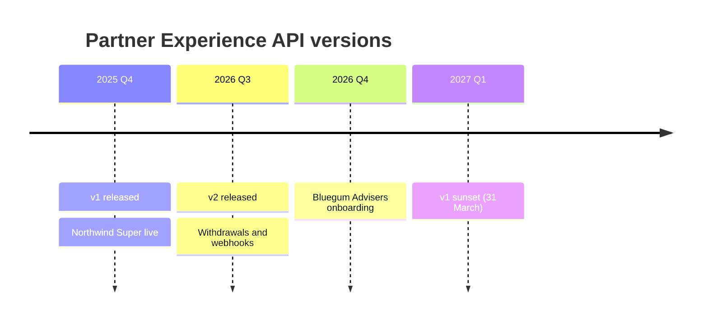
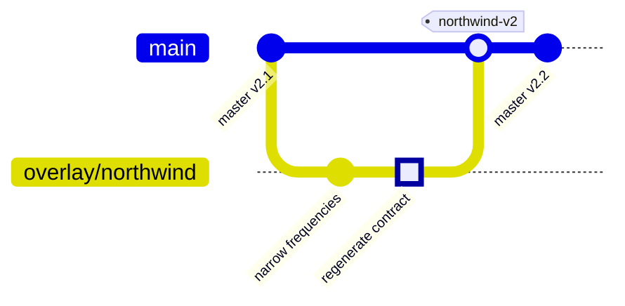
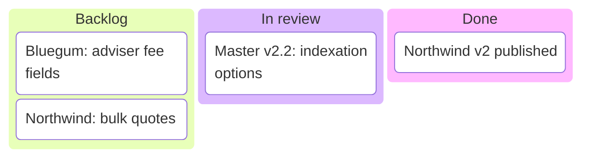

# Planning and change

Delivery plans, version history and how releases flow.

## Gantt chart

**Use it for:** Delivery plans and partner onboarding schedules.



<details>
<summary>Mermaid source</summary>

````text
gantt
  title Bluegum Advisers onboarding
  dateFormat YYYY-MM-DD
  axisFormat %d %b
  section Contract
    Overlay agreed           :done,    o1, 2026-09-01, 10d
    Contract published       :done,    o2, after o1, 2d
  section Build
    Sandbox integration      :active,  b1, 2026-09-15, 21d
    Webhook replacement poll :         b2, after b1, 7d
  section Go live
    Certification            :         g1, after b2, 5d
    Production launch        :milestone, g2, after g1, 0d
````

</details>

## Timeline

**Use it for:** Version history, deprecations and sunsets.



<details>
<summary>Mermaid source</summary>

````text
timeline
  title Partner Experience API versions
  2025 Q4 : v1 released : Northwind Super live
  2026 Q3 : v2 released : Withdrawals and webhooks
  2026 Q4 : Bluegum Advisers onboarding
  2027 Q1 : v1 sunset (31 March)
````

</details>

## Git graph

**Use it for:** Branching and release strategy for contracts.



<details>
<summary>Mermaid source</summary>

````text
gitGraph
  commit id: "master v2.1"
  branch overlay/northwind
  checkout overlay/northwind
  commit id: "narrow frequencies"
  commit id: "regenerate contract" type: HIGHLIGHT
  checkout main
  merge overlay/northwind tag: "northwind-v2"
  commit id: "master v2.2"
````

</details>

## Kanban board

**Use it for:** Work in progress for contract changes or partner requests.



<details>
<summary>Mermaid source</summary>

````text
kanban
  Backlog
    req1[Bluegum: adviser fee fields]
    req2[Northwind: bulk quotes]
  In review
    req3[Master v2.2: indexation options]
  Done
    req4[Northwind v2 published]
````

</details>
