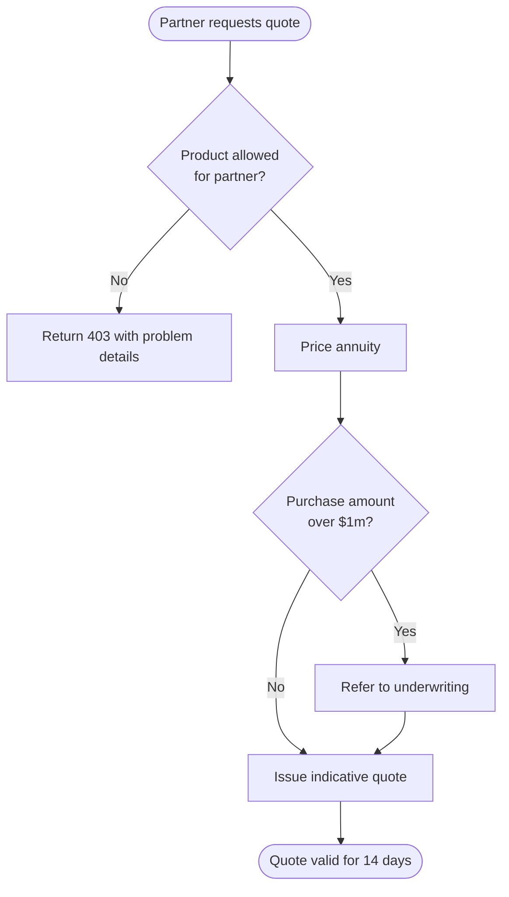
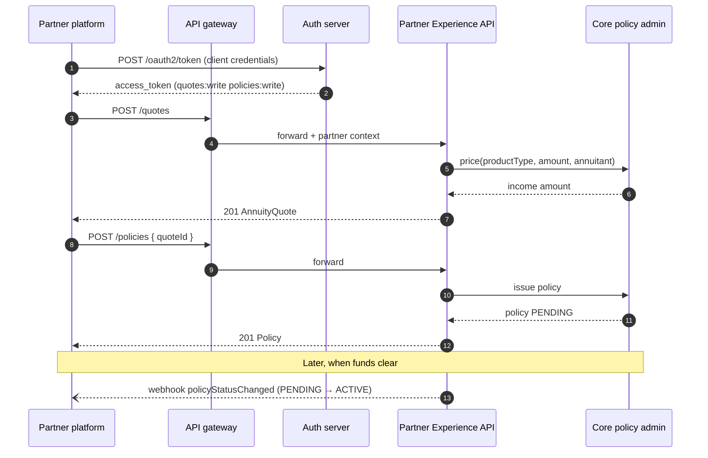
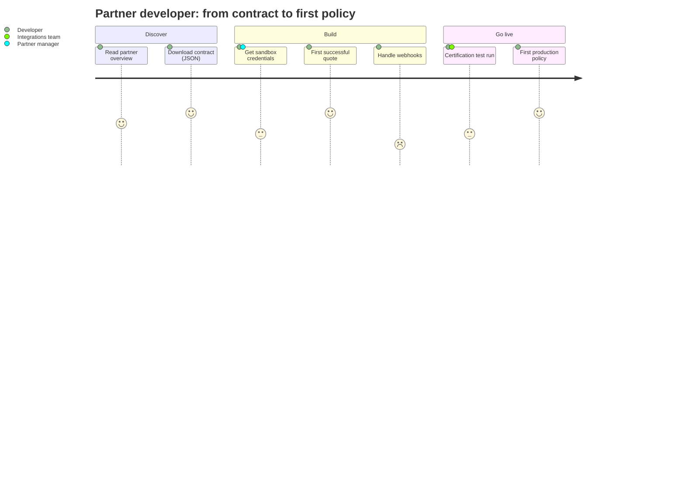

# Process and interaction

How work and requests move: between people, systems and partners.

## Flowchart

**Use it for:** Decision logic, approval processes, request routing.



<details>
<summary>Mermaid source</summary>

````text
flowchart TD
  A([Partner requests quote]) --> B{Product allowed<br/>for partner?}
  B -- No --> X[Return 403 with problem details]
  B -- Yes --> C[Price annuity]
  C --> D{Purchase amount<br/>over $1m?}
  D -- Yes --> E[Refer to underwriting]
  D -- No --> F[Issue indicative quote]
  E --> F
  F --> G([Quote valid for 14 days])
````

</details>

## Sequence diagram

**Use it for:** API call order across services, authentication flows, webhooks.



<details>
<summary>Mermaid source</summary>

````text
sequenceDiagram
  autonumber
  participant P as Partner platform
  participant G as API gateway
  participant A as Auth server
  participant X as Partner Experience API
  participant C as Core policy admin
  P->>A: POST /oauth2/token (client credentials)
  A-->>P: access_token (quotes:write policies:write)
  P->>G: POST /quotes
  G->>X: forward + partner context
  X->>C: price(productType, amount, annuitant)
  C-->>X: income amount
  X-->>P: 201 AnnuityQuote
  P->>G: POST /policies { quoteId }
  G->>X: forward
  X->>C: issue policy
  C-->>X: policy PENDING
  X-->>P: 201 Policy
  Note over C,P: Later, when funds clear
  X--)P: webhook policyStatusChanged (PENDING → ACTIVE)
````

</details>

## User journey

**Use it for:** How a partner developer or customer experiences a process, step by step.



<details>
<summary>Mermaid source</summary>

````text
journey
  title Partner developer: from contract to first policy
  section Discover
    Read partner overview: 4: Developer
    Download contract (JSON): 5: Developer
  section Build
    Get sandbox credentials: 3: Developer, Partner manager
    First successful quote: 5: Developer
    Handle webhooks: 2: Developer
  section Go live
    Certification test run: 3: Developer, Integrations team
    First production policy: 5: Developer
````

</details>
