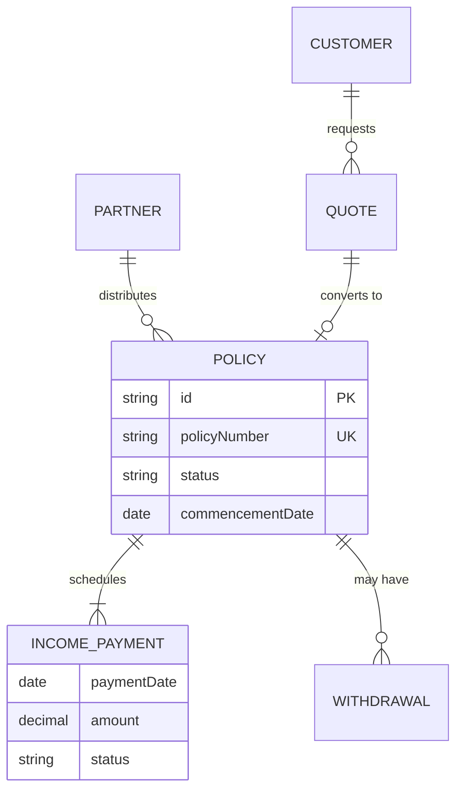
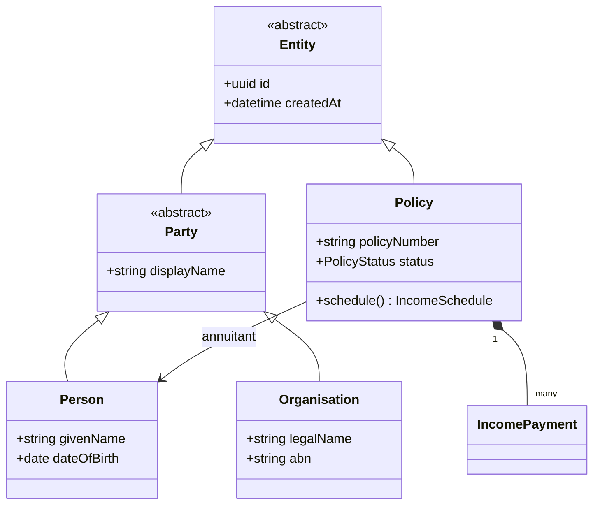
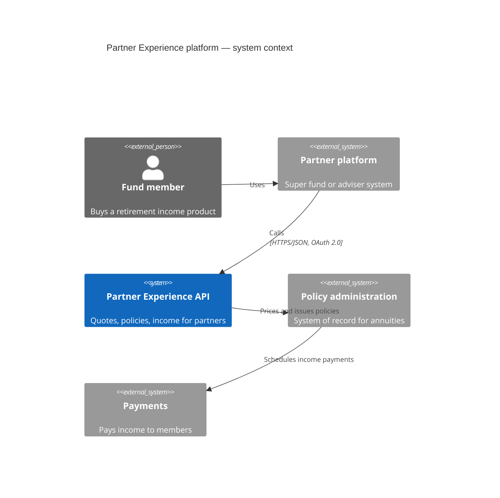
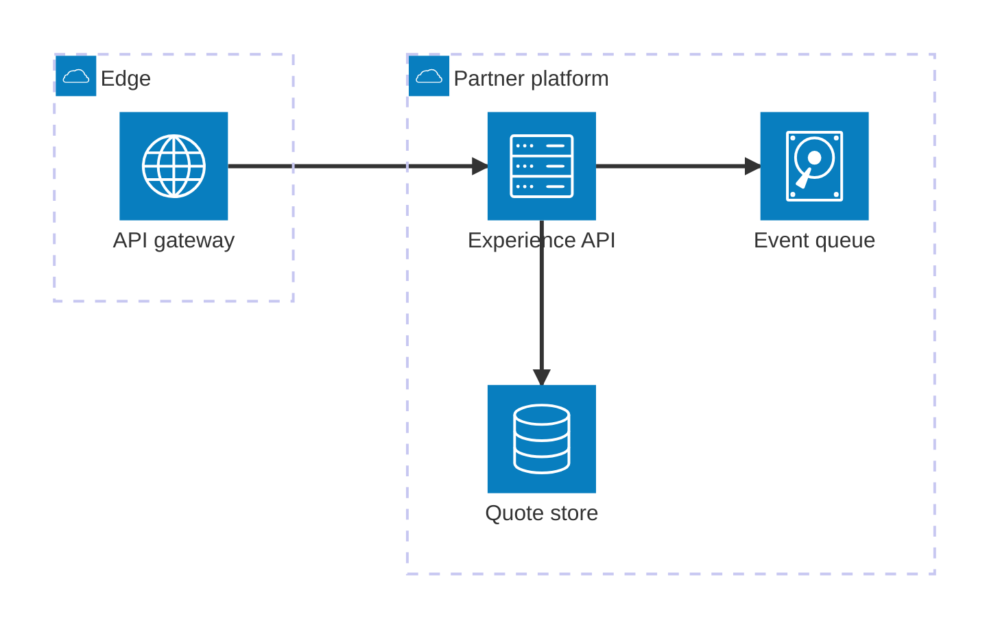
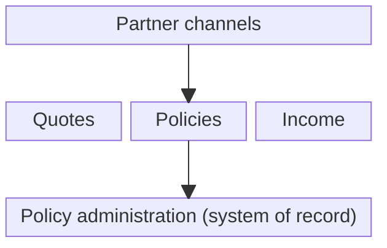
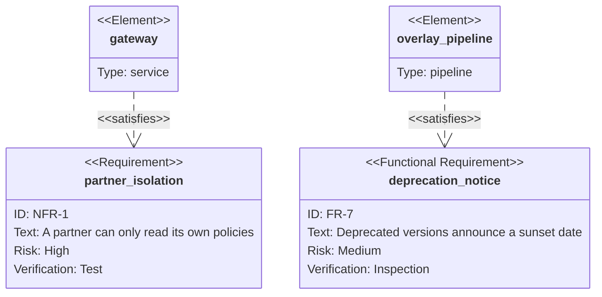

# Structure and data

What exists and how it relates: domain models, data stores, system context.

## Entity relationship diagram

**Use it for:** Database or data-model relationships with cardinality.



<details>
<summary>Mermaid source</summary>

````text
erDiagram
  PARTNER ||--o{ POLICY : distributes
  CUSTOMER ||--o{ QUOTE : requests
  QUOTE ||--o| POLICY : "converts to"
  POLICY ||--|{ INCOME_PAYMENT : schedules
  POLICY ||--o{ WITHDRAWAL : "may have"
  POLICY {
    string id PK
    string policyNumber UK
    string status
    date commencementDate
  }
  INCOME_PAYMENT {
    date paymentDate
    decimal amount
    string status
  }
````

</details>

## Class diagram

**Use it for:** Object models and inheritance, e.g. canonical model families.



<details>
<summary>Mermaid source</summary>

````text
classDiagram
  class Entity {
    <<abstract>>
    +uuid id
    +datetime createdAt
  }
  class Party {
    <<abstract>>
    +string displayName
  }
  class Person {
    +string givenName
    +date dateOfBirth
  }
  class Organisation {
    +string legalName
    +string abn
  }
  class Policy {
    +string policyNumber
    +PolicyStatus status
    +schedule() IncomeSchedule
  }
  Entity <|-- Party
  Party <|-- Person
  Party <|-- Organisation
  Entity <|-- Policy
  Policy "1" *-- "many" IncomePayment
  Policy --> Person : annuitant
````

</details>

## C4 context diagram

**Use it for:** Who uses the system and which external systems it talks to (C4 level 1).



<details>
<summary>Mermaid source</summary>

````text
C4Context
  title Partner Experience platform — system context
  Person_Ext(member, "Fund member", "Buys a retirement income product")
  System_Ext(partner, "Partner platform", "Super fund or adviser system")
  System(pex, "Partner Experience API", "Quotes, policies, income for partners")
  System_Ext(core, "Policy administration", "System of record for annuities")
  System_Ext(pay, "Payments", "Pays income to members")
  Rel(member, partner, "Uses")
  Rel(partner, pex, "Calls", "HTTPS/JSON, OAuth 2.0")
  Rel(pex, core, "Prices and issues policies")
  Rel(core, pay, "Schedules income payments")
````

</details>

## Architecture diagram

**Use it for:** Cloud and deployment topology with service groups.



<details>
<summary>Mermaid source</summary>

````text
architecture-beta
  group edge(cloud)[Edge]
  group platform(cloud)[Partner platform]
  service gw(internet)[API gateway] in edge
  service api(server)[Experience API] in platform
  service db(database)[Quote store] in platform
  service queue(disk)[Event queue] in platform
  gw:R --> L:api
  api:B --> T:db
  api:R --> L:queue
````

</details>

## Block diagram

**Use it for:** Layered capability or component views without flow direction.



<details>
<summary>Mermaid source</summary>

````text
block-beta
  columns 3
  partners["Partner channels"]:3
  space:3
  quote["Quotes"] policy["Policies"] income["Income"]
  space:3
  core["Policy administration (system of record)"]:3
  partners --> policy
  policy --> core
````

</details>

## Requirement diagram

**Use it for:** Trace requirements to the components that satisfy them.



<details>
<summary>Mermaid source</summary>

````text
requirementDiagram
  requirement partner_isolation {
    id: "NFR-1"
    text: "A partner can only read its own policies"
    risk: high
    verifymethod: test
  }
  functionalRequirement deprecation_notice {
    id: "FR-7"
    text: "Deprecated versions announce a sunset date"
    risk: medium
    verifymethod: inspection
  }
  element gateway {
    type: service
  }
  element overlay_pipeline {
    type: pipeline
  }
  gateway - satisfies -> partner_isolation
  overlay_pipeline - satisfies -> deprecation_notice
````

</details>
