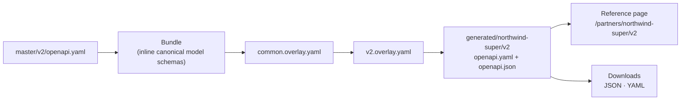

# Managing partner documentation

Every partner gets three things, all in one folder and all changed through pull requests:

1. **A contract**, generated from the master Partner Experience API by applying the partner's OpenAPI overlays.
2. **Documentation**: overview, onboarding, changelog, plus anything else the partner needs.
3. **Metadata** in `partner.yaml`: owner, contacts, status, and which master version and overlays each partner version uses.

```text
partner-experience/
  master/
    v1/openapi.yaml               ← master API, one folder per major version
    v2/openapi.yaml
  partners/
    northwind-super/
      partner.yaml                ← metadata (drives pages, contracts and review routing)
      index.mdx                   ← overview page: /partners/northwind-super/
      onboarding.md
      changelog.md
      overlays/
        common.overlay.yaml       ← applied to every Northwind version
        v1.overlay.yaml
        v2.overlay.yaml
  generated/                      ← written by the pipeline, never edited by hand
    northwind-super/v2/openapi.yaml
    northwind-super/v2/openapi.json
```

## How a partner contract is built



Overlays are applied in the order listed in `partner.yaml`. If an overlay action targets something that no longer exists in the master, for example a renamed path, **the build fails**. That stops a master change from silently changing what a partner receives.

## Changing a partner's contract

1. Create a branch and edit that partner's overlay, e.g. `partners/northwind-super/overlays/v2.overlay.yaml`.
2. Open a pull request. The **Partner contracts** workflow:
   - regenerates the affected contracts and commits them to your branch, so reviewers see the real contract diff;
   - lints the generated contracts;
   - comments a summary of what changed for each partner, flagging potentially breaking changes (removed operations or schemas, removed enum values, new required fields or headers). It also labels the PR `partner-breaking-change`.
3. Add an entry to the partner's `changelog.md`. The bot comment is a good starting point.
4. The partner's owning team reviews, then merge. The site redeploys with the new contract.

To run it locally first:

```bash
npm run partners          # regenerate all partner contracts
npm run partners:check    # what CI runs on main: fails if anything is out of date
node scripts/partners.mjs diff --base origin/main   # the PR summary, locally
```

## Changing the master API

Edit `master/<version>/openapi.yaml`. The same workflow regenerates **every** partner contract built on that version and summarises the impact on each partner. A single PR shows exactly which partners a master change reaches.

For a new major version, add `master/v3/openapi.yaml`, then opt partners in one at a time by adding a `v3` entry to their `partner.yaml`.

## Adding a partner

1. Copy an existing partner folder, rename it (lower-case, e.g. `harbour-wealth`), and edit `partner.yaml`.
2. Write the overlays: usually servers, info, then whatever this partner's agreement adds or removes.
3. Run `npm run partners`, commit everything including `generated/`, and open a PR.

The partner appears on the [Partners](pathname:///partners) page, in the footer, and gets its own sidebar.

## Versions and lifecycle

Set `status` on each version in `partner.yaml`:

| Status | Meaning | Shown as |
|---|---|---|
| `current` | Recommended version | Green pill |
| `deprecated` | Still running; add a `sunset` date | Amber pill, sunset date on every page |
| `retired` | Switched off; remove it from `partner.yaml` when you no longer need the page | Grey pill |

A partner-level `status` (`onboarding`, `active`, `sunset`) shows on the partner's overview and the Partners page.

## Ownership and review

`partner.yaml` names the owning GitHub team (`owner`). `npm run partners` keeps the partner section of `.github/CODEOWNERS` in sync, so changes to a partner's folder automatically request review from its team. Turn on **Require review from Code Owners** in branch protection to enforce it.

## Who can see what

This site is one private GitHub Pages site. **Everyone with read access to the repository can see every partner's pages**, so it suits internal teams.

To share material with a partner directly, use the **JSON / YAML downloads** on that partner's contract page and send the files through your usual secure channel. If partners need self-service access, publish their contracts to a portal with per-partner sign-in, or to a separate private site per partner. The generated files in `generated/<partner>/` are ready to publish anywhere.
