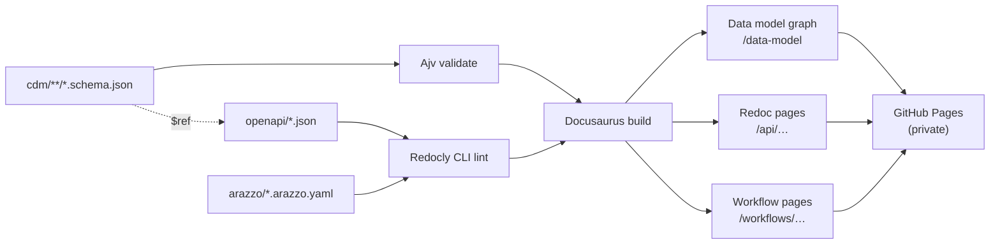

# Getting started

This portal publishes every internal API contract in one place:

- **API reference** — each OpenAPI description rendered with Redoc. Use the **API reference** menu in the navbar.
- **Workflows** — Arazzo descriptions showing how several APIs are called together, step by step, with a diagram and links into each operation.
- **Data model** — an interactive graph of the canonical JSON Schemas every contract is built from. Click a model to see its properties, inheritance and where it's used. See [Canonical data model](guides/canonical-data-model.md).

Everything on this site is generated from files in the repository, so the docs never drift from the contracts. When a contract changes on `main`, the site rebuilds and redeploys automatically.

## Who can see this site

The site is published as a **private GitHub Pages site**. Only people signed in to GitHub with read access to the repository can open it. If you can't see it, ask the repository admins for access.

## How the pieces fit

