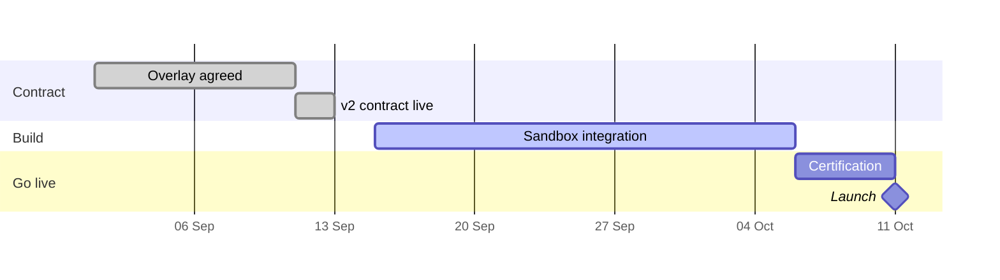

import PartnerOverview from '@site/src/components/portal/PartnerOverview';

# Bluegum Advisers

Financial advice network quoting annuities for clients through its adviser platform. **Currently onboarding.**

<PartnerOverview partner="bluegum-advisers" />

## What's different for Bluegum

| Area | Bluegum's contract |
|---|---|
| Identification | `X-Adviser-Id` header on **every** operation |
| Notifications | No webhooks — Bluegum polls `GET /policies` |
| Products | All master products |

## Onboarding plan

