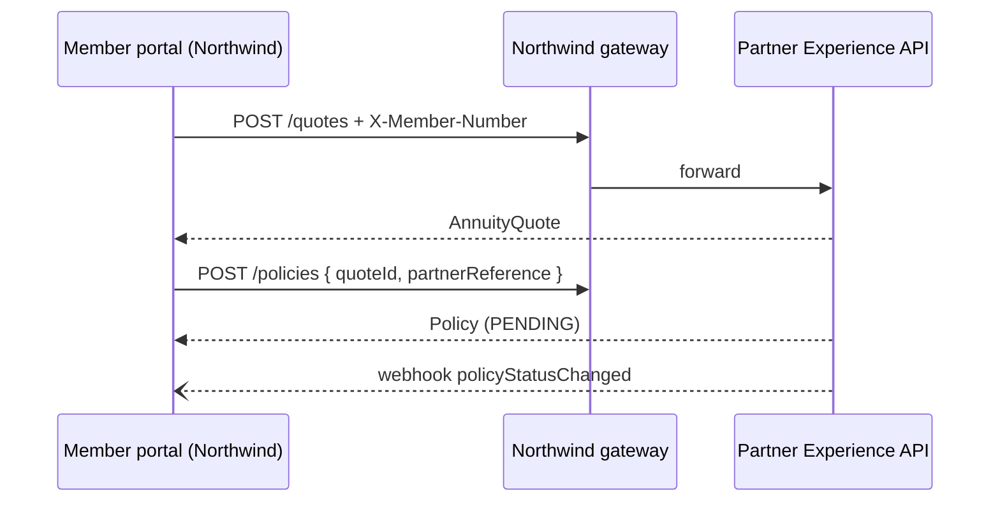

import PartnerOverview from '@site/src/components/portal/PartnerOverview';

# Northwind Super

Superannuation fund offering our lifetime and deferred lifetime annuities to members at retirement, through its member portal.

<PartnerOverview partner="northwind-super" />

## What's different for Northwind

| Area | Northwind's contract |
|---|---|
| Products | `LIFETIME` and `DEFERRED_LIFETIME` only |
| Income frequency | Monthly or quarterly |
| Withdrawals | Not offered (removed from v2) |
| Identification | `X-Member-Number` header on quote requests |
| Gateway | Dedicated: `northwind.partners.api.example.com` |

These differences live in the overlays under `partner-experience/partners/northwind-super/overlays/`, never in the master API.

## Integration at a glance

